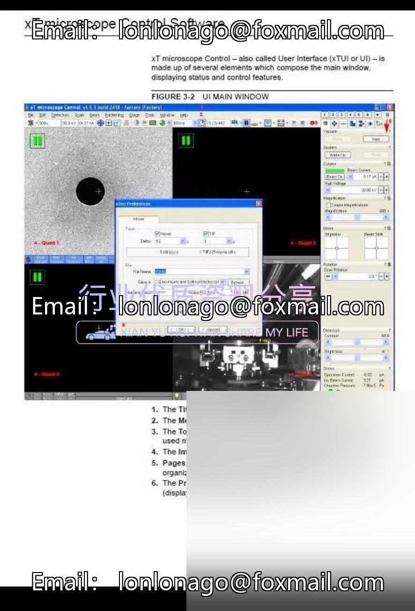
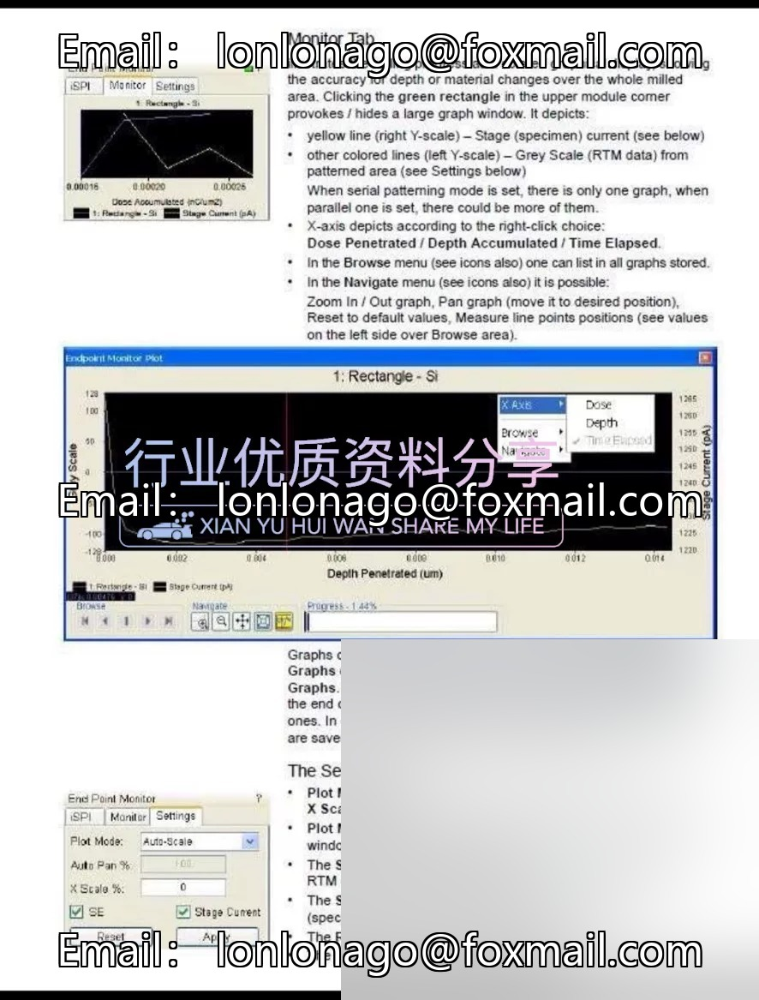
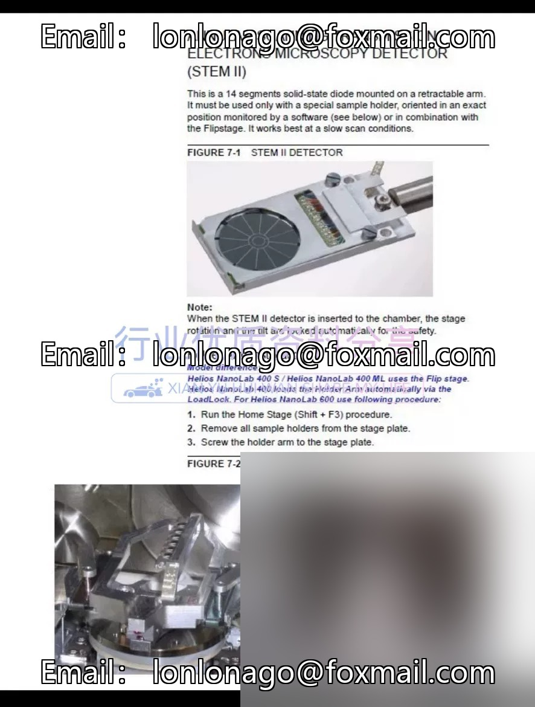
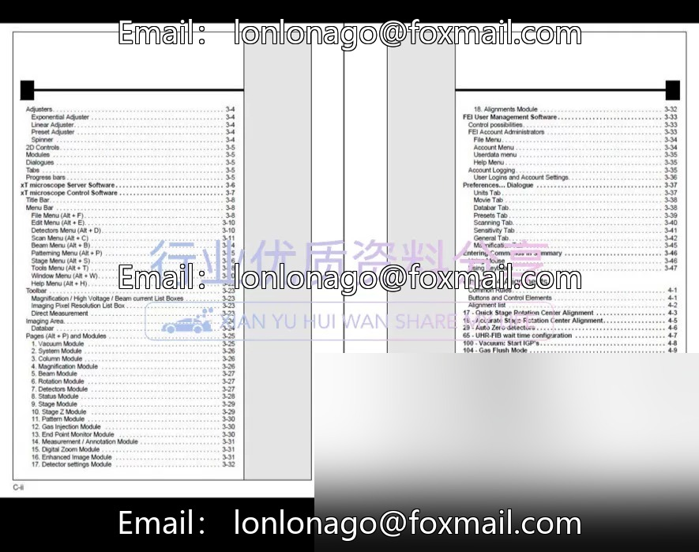

# Thermo Fisher Helios NanoLab 400/600 series focuses on

## Body

Seemless Helios NanoLab 400/600 series focused ion beam/scanning electron microscope SEM technology manual (including detailed introduction of equipment structure and operation maintenance), of great reference value.

Capture and send the electronic original directly! The following images include screenshots of the file portion. Please confirm before placing the order! Due to the replicable nature of electronic documentation Therefore, are allowed after purchase! Thanks for understanding!

The SEM technology manual for the Thermo Fisher Helios NanoLab 400/600 series covers equipment structure and operation/maintenance details, while the images show the device interface and software features.

<!-- AI_ENRICHED -->

## Images

## Payment

Here is a pay link on Stripe ( https://buy.stripe.com/3cs8yP7sY87d0vu9AB ). Please contact me lonlonago@foxmail.com after funding $89, and I will send you a complete data files , thank you!

